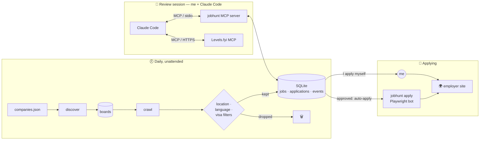
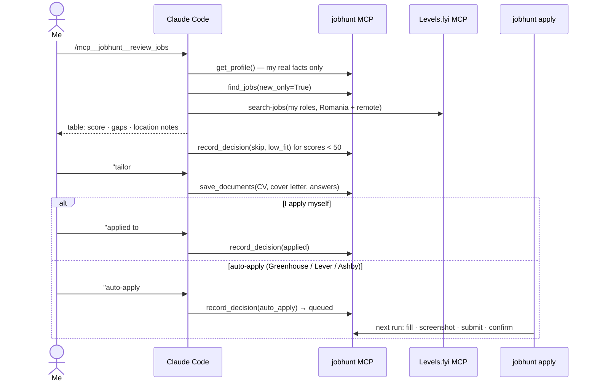
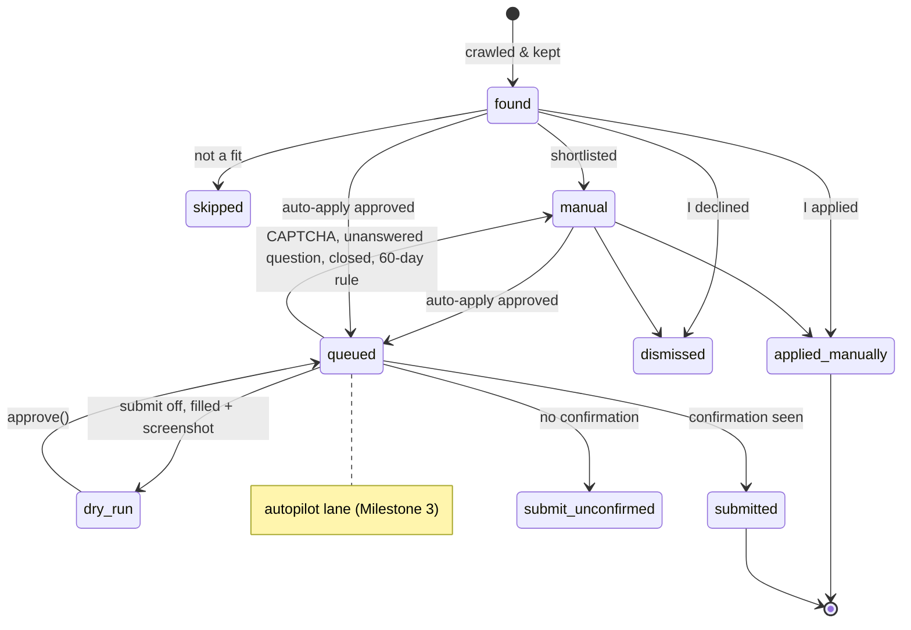
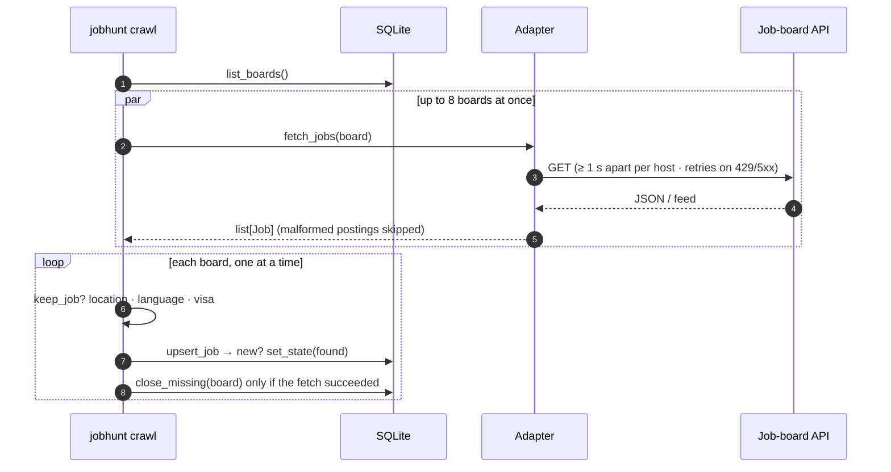
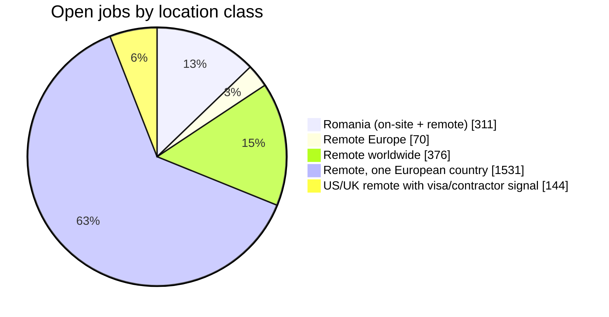
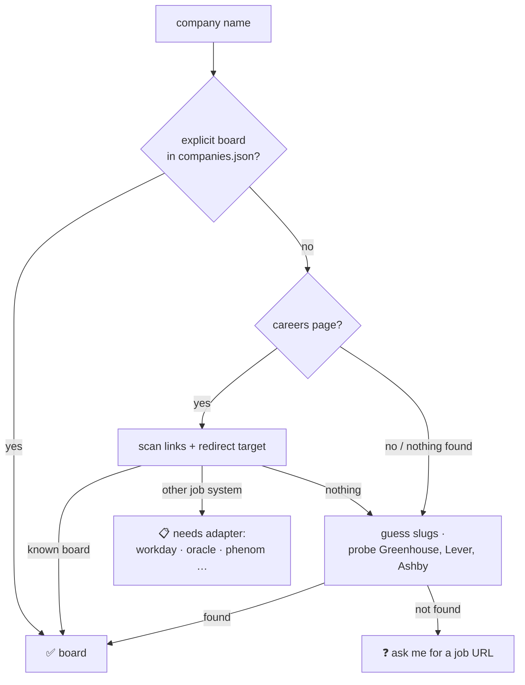
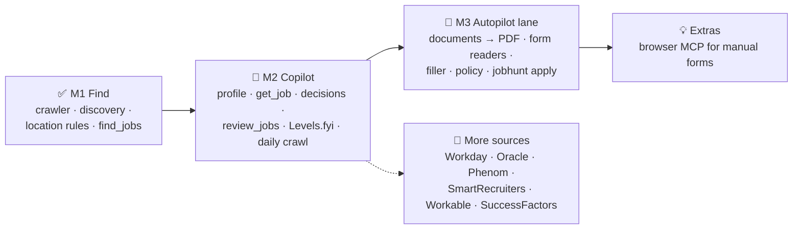

<div align="center">

# 🔎 jobhunt — Job Hunt Copilot

**A crawler that finds tech jobs I can actually take from Romania,
an MCP server that lets Claude work through them with me,
and a bot that submits the ones I approve.**


</div>

---

## ✨ What it does

| | |
|---|---|
| 🕷️ **Finds** | Reads the public job boards of 135 companies every day and keeps only jobs I can take: in Romania, remote in Europe or worldwide, remote in another European country with English only, or US/UK remote with visa sponsorship or contractor terms. |
| 🗄️ **Remembers** | One SQLite database with an application state machine and an audit log: what's new, what I skipped, what I applied to. |
| 🤖 **Reviews with Claude** | An MCP server lets Claude (in Claude Code) score each new job against my real CV, explain the gaps and tailor a CV and cover letter — from true facts only. |
| 🌐 **Searches live** | In the same session Claude also queries the official [Levels.fyi MCP server](https://www.levels.fyi/llms.txt). |
| 🙋 **Two lanes** | I submit most applications myself. For jobs I explicitly approve on standard forms (Greenhouse, Lever, Ashby), a bot fills and submits them — dry-run first, with evidence for every submit. |

> **Live (2026-11-22):** **135 companies → 51 job boards → 2,432 open jobs, 311 in Romania.**
> Milestone 1 *Find* ✅ · Milestone 2 *Copilot* 🚧 · Milestone 3 *Autopilot lane* 📝

---

## 🧭 The big picture



**One database, three roles.** The crawler only *writes jobs*. Claude *reads jobs and writes decisions*. The bot *submits only what I approved*. Collecting (≈ 1 minute for 51 boards, polite) is kept apart from querying (milliseconds), so a review session never hits anyone's server.

---

## 🔁 A review session



---

## 🗄️ Application states



Every transition is checked against an `ALLOWED` table (illegal moves raise `InvalidTransition`) and appended to an `events` audit log. `submit_unconfirmed` is shown to me — never counted as done.

---

## 🕷️ The crawl



- **Polite:** one shared client — ≥ 1 s between requests to the same host, 3 retries with exponential backoff, generic `jobhunt/0.1` user agent.
- **Robust:** one board's error is recorded and the rest carry on; a failed board never closes its jobs.
- **Idempotent:** crawling twice changes only `last_seen_at`; a decision is never reset.

---

## 📍 Which jobs are kept

Every office in a posting is classified; **any one kept office keeps the job**.

| Class | Example | Kept when | Open jobs now |
|---|---|---|---:|
| 🇷🇴 `romania` | `Bucharest, Romania`, `Iași`, `Cluj-Napoca` | always | 169 |
| 🏠 `remote-romania` | `Remote - Romania` | always | 142 |
| 🇪🇺 `remote-europe` | `Remote (EMEA)`, `Remote in Europe` | always | 70 |
| 🌍 `remote-global` | `Remote`, `Worldwide` | only global words in the location | 376 |
| 🏳️ `remote-europe-country` | `Remote Germany`, `Remote - Poland` | no language besides English (or Romanian) required | 1,531 |
| 🛂 `remote-needs-visa` | `Remote - US`, `Remote - London, UK` | visa sponsorship, contractor (B2B) terms or hiring abroad | 144 |
| ❌ `other` | `New York, NY`, `Remote - Seoul` | never | — |



Lessons baked in from live crawls: unknown places **fail closed** (an *allowlist* of scope words), and visa / contractor signals are read from the role text, never from boilerplate links.

---

## 🔌 Job sources



| System | Adapter | Example companies |
|---|---|---|
| Greenhouse | ✅ `ats/greenhouse.py` | Anthropic, GitLab, Datadog, Elastic, eMAG, Bitdefender, Axon, N-iX |
| Ashby | ✅ `ats/ashby.py` | OpenAI, Linear, UiPath, Supabase, Kraken, Partyhat |
| Lever | ✅ `ats/lever.py` | Jobgether, Palantir, Spotify, Everseen (EU) |
| softgarden | ✅ `ats/softgarden.py` | Orange Romania |
| **Workday** | 📝 next | NXP, LSEG, CrowdStrike, Deutsche Bank, QIAGEN, GE Vernova … (10+) |
| Oracle Recruiting | 📝 | Oracle, Vertiv, Emerson, ACI Worldwide |
| Phenom · Workable · SmartRecruiters · SuccessFactors · iCIMS | 📝 | Adobe, Cisco, FlowX.AI, Bosch, Schaeffler, Keysight |

`jobhunt discover` ends with the ranking that decides what gets built next:

```
needs adapter: workday 10 (CrowdStrike, NXP, Safeguard Global, Siemens Healthineers, QIAGEN, LSEG, …)
needs adapter: oracle 5 (Oracle, ACI Worldwide, Emerson, Vertiv, Ciklum)
needs adapter: phenom 3 (Adobe, Cisco, Thales)
…
```

**Never touched:** LinkedIn, Gmail, and any site that answers automated requests with 401/403 or a bot challenge — those are skipped, not worked around.

---

## 🤖 MCP tools

| Tool | Milestone | What it does |
|---|:---:|---|
| `find_jobs(query, location_class, country, posted_since_days, min_score, contractor_ok, limit)` | ✅ 1 | open jobs, best score first, with `visa_sponsorship` and `contractor_ok` |
| `get_profile()` | 🚧 2 | my real CV facts and answers — the *only* facts Claude may use |
| `get_job(job_id)` | 📝 2 | the full posting |
| `record_decision(job_id, decision, score, reason)` | 📝 2 | shortlist · skip · applied · dismiss · auto_apply |
| `my_applications(...)` · `find_jobs(new_only=True)` | 📝 2 | history, 60-day same-company check, never-reviewed jobs |
| `record_external_job(...)` | 📝 2 | keep a job found on Levels.fyi |
| prompt `review_jobs` | 📝 2 | the session playbook: score, skip, table, tailor, record |
| `save_documents(job_id, cv, cover_letter, answers)` | 📝 3 | Markdown → PDF under `data/applications/{job}/` |
| `job_questions(job_id)` | 📝 3 | a form's custom questions, answered in the session |
| `approve(job_id)` · `application_status(job_id)` | 📝 3 | release a dry-run; see evidence and confirmation |

---

## 🛡️ Autopilot lane safety rails

| Rail | |
|---|---|
| ✋ **Approval per job** | only jobs I mark `auto_apply` in a session |
| 📄 **Standard forms only** | Greenhouse, Lever, Ashby — everything else stays manual |
| 🤐 **No guessing** | standard fields from my answers file; free-text questions only from answers written in the session |
| 🧪 **Dry-run first** | the bot fills and screenshots without submitting until I turn submitting on |
| 🧾 **Evidence** | screenshot, files sent, answers given, confirmation text — no confirmation means `submit_unconfirmed` |
| 🚦 **Limits** | posting still open · 10 submits per calendar day · one application per company per 60 days |
| 🧱 **Stops on** | CAPTCHA, login wall, unknown field type → back to me |

---

## 🗺️ Roadmap



---

## 🚀 Quick start

```bash
uv sync                                   # Python 3.15 and all dependencies
uv run pytest -q                          # the test suite
uv run jobhunt discover                   # companies.json → job boards (+ needs-adapter ranking)
uv run jobhunt crawl                      # boards → data/jobhunt.db
claude mcp add jobhunt -- uv --directory ~/eu-tech-jobs run jobhunt serve
```

Then, in a new Claude Code session: *"Find remote Python jobs open to Romania."*

| Setting | Default | |
|---|---|---|
| `JOBHUNT_DB` | `data/jobhunt.db` | database file |
| `JOBHUNT_PROFILE` | `profile/` | private CV facts and form answers (format: `profile.example/`) |

Add a company by editing `companies.json` — a name is enough; discovery finds the board. Give a careers page or an explicit board when the name alone can't:

```json
{"name": "GitLab"}
{"name": "NXP", "careers_url": "https://nxp.myworkdayjobs.com/careers"}
{"name": "Kraken", "board": {"ats": "ashby", "slug": "kraken.com"}}
```

---

## 🕗 Daily crawl

`scripts/daily.sh` runs the crawl from the repo root (wherever it is called from) and appends timestamped output to `data/logs/daily-YYYY-MM-DD.log`. It exits non-zero when a step fails. Try it once by hand:

```bash
scripts/daily.sh && tail data/logs/daily-$(date +%F).log
```

**Missed runs are harmless.** The crawl is idempotent: the next run picks up every job still open and never resets a decision. Skipping a day only means a job that opened and closed in between is never seen.

**Option A — cron inside WSL.** Add this line with `crontab -e`:

```cron
0 8 * * * ~/eu-tech-jobs/scripts/daily.sh
```

WSL does not start cron by itself, and cron only fires while the WSL VM is running (WSL stops a while after the last terminal closes; a sleeping laptop runs nothing). To start cron with WSL, either turn on systemd in `/etc/wsl.conf` and enable the service:

```ini
[boot]
systemd=true
```

```bash
sudo systemctl enable --now cron
```

or, without systemd, start it at boot instead:

```ini
[boot]
command="service cron start"
```

Then run `wsl --shutdown` from Windows and open WSL again. Check with `service cron status`.

**Option B — Windows Task Scheduler (recommended on a laptop).** Windows starts WSL itself, and *run as soon as possible after a missed start* covers sleep. In PowerShell:

```powershell
$action   = New-ScheduledTaskAction -Execute "wsl.exe" -Argument "-e bash -lc ~/eu-tech-jobs/scripts/daily.sh"
$trigger  = New-ScheduledTaskTrigger -Daily -At 08:00
$settings = New-ScheduledTaskSettingsSet -StartWhenAvailable
Register-ScheduledTask -TaskName "jobhunt daily" -Action $action -Trigger $trigger -Settings $settings
```

Add `-d <distro>` before `-e` if Ubuntu is not your default distro. Use one option, not both.

---

## 🗂️ Project layout

```
src/jobhunt/
├── models.py · enums.py      Company, Board, Office, Job · Ats, LocationClass, AppState
├── db.py                     SQLite schema, upserts, state machine, audit log
├── http.py                   PoliteClient: per-host spacing, retries, backoff, redirects
├── location.py · filters.py  where a job is · whether to keep it (language, visa, contractor)
├── ats/                      one adapter per job-board system · detect_board · detect_system
├── seed/                     companies.json loader · board discovery
├── crawl.py                  concurrent fetch, sequential writes, close vanished jobs
├── queries.py                search_jobs → JobSummary
├── mcp_server.py             MCP tools for Claude
└── cli.py                    jobhunt discover | crawl | serve
scripts/daily.sh              the unattended daily run · logs to data/logs/
tests/                        mirrors src/ · fixtures/ are recorded real responses
docs/design.md                goals, trade-offs and decisions
docs/learning/                interview-ready notes: MCP · crawling · state machine
```

---

## 🧪 Quality bar

- **Test-first** for every feature; recorded real API responses as fixtures; HTTP mocked with `respx`.
- **Live tuning passes** turned real false positives into tests (a privacy-policy link is not a "contractor" signal; *"anywhere in the United States"* is not abroad).
- `ruff`, `ruff format` and `mypy --strict` clean; a pre-commit hook runs ruff on staged files.

## 📐 Design

Goals, trade-offs and decisions: [docs/design.md](docs/design.md). Interview-style notes on each part: [docs/learning/](docs/learning/).

## 🔒 Privacy

`profile/` (CV facts, answers), `data/` (database, tailored documents) and `.env` are gitignored from the first commit. No salary data is stored.

## 🙏 Credits

Modelled on [spanish-top-tech-companies](https://github.com/pugarte7/spanish-top-tech-companies) (MIT, © 2026 Pablo Ugarte); the country and city tables in `location.py` were adapted from it. Its `data/` directory is under a separate licence and is not used here.
