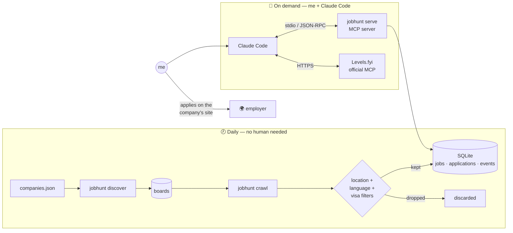
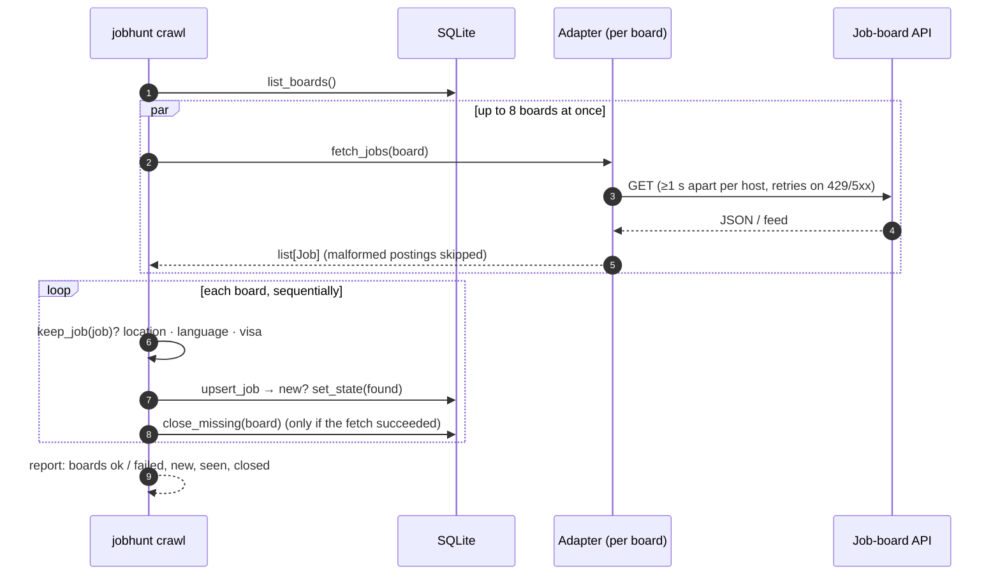
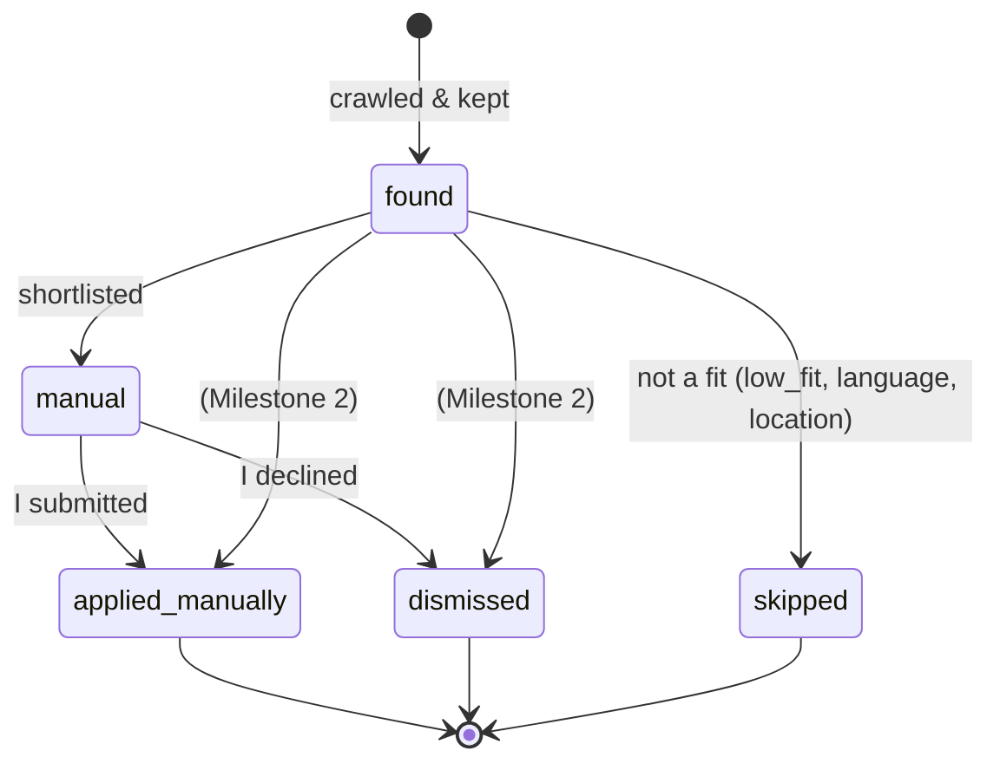
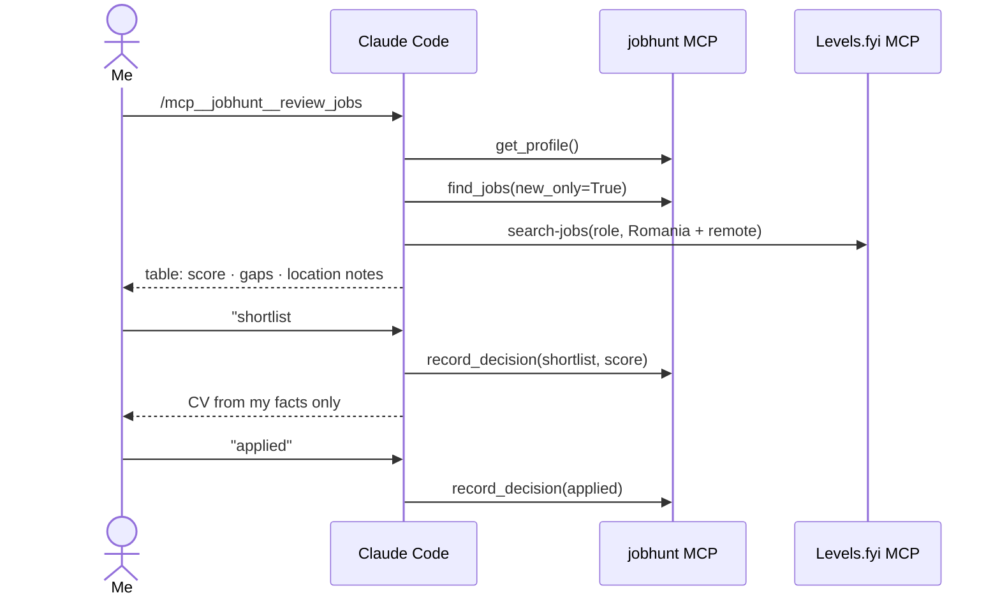

<div align="center">

# 🔎 jobhunt — Job Hunt Copilot

**A crawler that finds tech jobs I can actually take from Romania,
and an MCP server that lets Claude work through them with me.**


</div>

---

## ✨ What it does

| | |
|---|---|
| 🕷️ **Finds** | Reads the public job boards of the companies I care about (Greenhouse, Lever, Ashby, softgarden) and keeps only jobs I can take: in Romania, remote in Europe, remote worldwide, remote in another European country with English only, or US/UK remote with visa sponsorship / contractor terms. |
| 🗄️ **Remembers** | Stores every job in one SQLite database with an application state machine and an audit log: what's new, what I skipped, what I applied to. |
| 🤖 **Works with Claude** | Exposes the database as an MCP server. In Claude Code I ask *"find remote Python jobs open to Romania"* and Claude calls my `find_jobs` tool. |
| 🌐 **Searches live too** | Claude can also query the official [Levels.fyi MCP server](https://www.levels.fyi/llms.txt) in the same session. |
| 🙋 **I decide** | No auto-submit. Claude reviews, scores and tailors; I read everything and submit myself. |

> **Status (2026-11-22):** Milestone 1 *Find* is done and live — **134 companies → 45 boards → 2,318 open jobs, 231 in Romania**.
> Milestone 2 *Copilot* (profile, decisions, review prompt) is in progress.

---

## 🧭 How it fits together



**Two halves, one database.** The crawler only *writes jobs*; Claude only *reads jobs and writes decisions*. Collecting (12 s for 45 boards, polite) is kept apart from querying (milliseconds), so asking Claude never hits anyone's server.

---

## 🕷️ The crawl, step by step



- **Polite:** one shared `PoliteClient` — ≥ 1 s between requests to the same host, 3 retries with exponential backoff, generic `jobhunt/0.1` user agent.
- **Robust:** one board's error (429, timeout, odd JSON) is recorded and the rest carry on; a failed board never closes its jobs.
- **Idempotent:** crawling twice changes nothing but `last_seen_at`; a decision like `applied` is never reset.

---

## 📍 Which jobs are kept

Every office in a posting is classified; **any one kept office keeps the job**.

| Class | Example | Kept when |
|---|---|---|
| 🇷🇴 `romania` | `Bucharest, Romania`, `Iași`, `Cluj-Napoca` | always |
| 🏠 `remote-romania` | `Remote - Romania` | always |
| 🇪🇺 `remote-europe` | `Remote (EMEA)`, `Remote in Europe` | always |
| 🌍 `remote-global` | `Remote`, `Worldwide`, `Home based - Worldwide` | always — only if *nothing but* global words |
| 🏳️ `remote-europe-country` | `Remote Germany`, `Remote - London, UK` | no language besides English (or Romanian) required |
| 🛂 `remote-needs-visa` | `Remote - US`, `Remote, United Kingdom` | posting offers visa sponsorship, accepts contractors (B2B) or hires abroad |
| ❌ `other` | `New York, NY`, `Remote - Seoul`, `Remote, AMER` | never |

Lessons baked in from the first live crawl: unknown places **fail closed** (an *allowlist* of scope words, not a list of every country), and signals are read from the role text, never from boilerplate links.

---

## 🗄️ Application states



Every transition is checked against an `ALLOWED` table (illegal moves raise `InvalidTransition`) and appended to an `events` audit log.

---

## 🔌 Job sources

| System | Adapter | Read from | Companies (examples) |
|---|---|---|---|
| Greenhouse | `ats/greenhouse.py` | `boards-api.greenhouse.io` | Anthropic, GitLab, Datadog, Elastic, eMAG, Axon, N-iX, Bitpanda… |
| Ashby | `ats/ashby.py` | `api.ashbyhq.com` | OpenAI, Linear, UiPath, Supabase, Partyhat, Solvd… |
| Lever | `ats/lever.py` | `api.lever.co` / `api.eu.lever.co` | Jobgether, Palantir, Spotify, Kraken, SwissBorg |
| softgarden | `ats/softgarden.py` | `{site}/jobs.feed.json` | Orange Romania |

Boards are found by **discovery**: scan a company's careers page for board links (and where it redirects), else guess slugs and probe. Companies on systems without an adapter yet are reported as `needs adapter: workday 14 (…)` — that ranking decides what gets built next (Workday, SmartRecruiters, Workable, Amazon, Oracle, SuccessFactors — see [design](docs/design.md)).

**Never touched:** LinkedIn, Gmail, and any site that answers automated requests with 401/403 or a bot challenge — those are skipped, not worked around.

---

## 🤖 MCP tools

| Tool | Status | What Claude gets |
|---|---|---|
| `find_jobs(query, location_class, country, posted_since_days, min_score, contractor_ok, limit)` | ✅ | open jobs, best score first, each with `visa_sponsorship` and `contractor_ok` |
| `get_profile()` | 🚧 Task 9 | my real CV facts — the *only* facts Claude may use |
| `get_job(job_id)` | 📝 Task 10 | the full posting |
| `record_decision(job_id, decision, score, reason)` | 📝 Task 11 | shortlist / skip / applied / dismiss |
| `my_applications(...)`, `find_jobs(new_only=True)` | 📝 Task 12 | history and "never reviewed" |
| `record_external_job(...)` | 📝 Task 12b | keep a job found on Levels.fyi |
| prompt `review_jobs` | 📝 Task 13 | the session playbook: score, skip, table, tailor, record |



---

## 🚀 Quick start

```bash
uv sync                                   # Python 3.15, all dependencies
uv run pytest -q                          # 244 tests
uv run jobhunt discover                   # companies.json → job boards
uv run jobhunt crawl                      # boards → data/jobhunt.db
claude mcp add jobhunt -- uv --directory ~/eu-tech-jobs run jobhunt serve
```

Then, in a new Claude Code session: *"Find remote Python jobs open to Romania."*

| Setting | Default | |
|---|---|---|
| `JOBHUNT_DB` | `data/jobhunt.db` | database file |
| `JOBHUNT_PROFILE` | `profile/` | private CV facts and form answers (see `profile.example/`) |

Add a company by editing `companies.json` — a name is enough; a known board can be given explicitly:

```json
{"name": "Orange Romania", "board": {"ats": "softgarden", "slug": "cariere.orange.ro"}}
```

---

## 🗂️ Project layout

```
src/jobhunt/
├── models.py · enums.py      Company, Board, Office, Job · Ats, LocationClass, AppState
├── db.py                     SQLite schema, upserts, state machine, audit log
├── http.py                   PoliteClient: per-host spacing, retries, backoff
├── location.py · filters.py  where a job is · whether to keep it (language, visa, contractor)
├── ats/                      one adapter per job-board system + detect_board / detect_system
├── seed/                     companies.json loader · board discovery
├── crawl.py                  concurrent fetch, sequential writes, close vanished jobs
├── queries.py                search_jobs → JobSummary
├── mcp_server.py             MCP tools for Claude
└── cli.py                    jobhunt discover | crawl | serve
tests/                        mirrors src/; fixtures/ are recorded real responses
docs/learning/                interview-ready notes: MCP · crawling · state machine
```

---

## 🧪 Quality bar

- **Test-first** for every feature; recorded real API responses as fixtures; HTTP mocked with `respx`.
- **Two live tuning passes** turned real false positives into tests (OpenAI's privacy-policy link was not a "contractor" signal; *"anywhere in the United States"* is not abroad).
- `ruff`, `ruff format` and `mypy --strict` clean; a pre-commit hook runs ruff on staged files.

## 📐 Design

Goals, trade-offs and decisions: [docs/design.md](docs/design.md). Interview-style notes on each part: [docs/learning/](docs/learning/).

## 🔒 Privacy

`profile/` (CV facts, answers), `data/` (database) and `.env` are gitignored from the first commit. No salary data is stored.

## 🙏 Credits

Modelled on [spanish-top-tech-companies](https://github.com/pugarte7/spanish-top-tech-companies) (MIT, © 2026 Pablo Ugarte); the country and city tables in `location.py` were adapted from it. Its `data/` directory is under a separate licence and is not used here.
